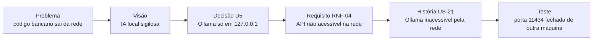

> [!info] Conexões
> Continua [[01-bmad/o-que-e-bmad]]. Resume em [[01-bmad/index]]. Alimenta [[02-visao-do-produto/index]] e [[03-requisitos/index]].

## Mapa fase a fase

| Fase BMAD | Papel | Pergunta | Documento do projeto | Situação |
| --- | --- | --- | --- | --- |
| **Análise** | Analista | Qual é o problema e o contexto? | [[contexto/empresa-e-problema]] | Pronto |
| **Análise** | Analista | O que será e o que não será feito? | [[contexto/proposta-e-delimitacao]] | Pronto |
| **Análise** | Analista | Que alternativas técnicas existem? | [[referencias/modelos-candidatos]] | Pronto; modelo adotado justificado ([[referencias/modelos-candidatos#Justificativa da escolha\|ver]]) |
| **Análise → Brief** | Analista | Qual é a visão resumida? | [[02-visao-do-produto/index]] | Pronto |
| **Planejamento** | PM | O que o produto deve fazer? | [[03-requisitos/backlog-do-produto]] | Pronto (rascunho a validar) |
| **Planejamento** | PM | Com que qualidade? | [[03-requisitos/requisitos-nao-funcionais]] | Pronto (rascunho a validar) |
| **Solução** | Arquiteto | Como será construído? | [[02-visao-do-produto/arquitetura-da-solucao]], [[atividades/atividade-1-servidor-padrao]], [[atividades/atividade-3-infraestrutura-e-distribuicao]] | Pronto |
| **Solução** | PO/SM | Em que ordem e com que critérios? | [[03-requisitos/backlog-do-produto]] (prioridades e fases) | Pronto |
| **Solução** | Arquiteto | Quanto custa? | [[atividades/atividade-2-custos-e-instalacao-llm]], [[02-visao-do-produto/analise-economica]] | Pronto |
| **Implementação** | Dev | Servidor e modelo instalados | Atividades 1 e 2 (roteiros) | Roteiros entregues; execução pendente |
| **Implementação** | Dev | Interface, fila, gateway | Histórias E2, E3, E1 | Protótipo ainda sem registro |
| **Validação** | QA | A solução funciona e compensa? | [[03-requisitos/backlog-do-produto#Épico E7: Medição e validação do piloto\|Épico E7]] e [[referencias/criterios-de-avaliacao]] | Depende do piloto |

## Rastreabilidade: do problema à história

Exemplo de cadeia completa:

## Registro de decisões

| # | Decisão | Motivo | Alternativas | Fonte |
| --- | --- | --- | --- | --- |
| D1 | IA própria = modelo pré-treinado | Treinar do zero é inviável para o prazo e o hardware | Treino próprio | [[contexto/proposta-e-delimitacao]] |
| D2 | Foco em perguntas, explicação e correção | Manter viável; não prometer substituição total | Cobertura completa | [[contexto/proposta-e-delimitacao]] |
| D3 | Qwen2.5-Coder 14B via Ollama | Cabe na GPU de 24 GB com margem (≈ 12,9 GiB), licença Apache 2.0 e qualidade próxima à do 32B (48,4% contra 49,6% no BigCodeBench) | Modelos de 15 a 19 GB | [[atividades/atividade-2-custos-e-instalacao-llm]] |
| D4 | Fila com uma geração por vez | Atende 15 usuários com previsibilidade | Paralelismo imediato | [[atividades/atividade-2-custos-e-instalacao-llm]] |
| D5 | Gateway autenticado + Ollama em `127.0.0.1` | A API do Ollama não exige senha | Expor a API | [[atividades/atividade-1-servidor-padrao]] |
| D6 | Fases: piloto → 3 equipes → IDE | Reduzir risco e medir antes de ampliar | Implantação única | [[atividades/atividade-3-infraestrutura-e-distribuicao]] |
| D7 | Externas mantidas como contingência | Servidor único precisa de plano B | Desligar as externas | [[atividades/atividade-3-infraestrutura-e-distribuicao]] |
| D8 | Backlog de histórias | Combina com BMAD e permite priorizar por fase | Requisitos tradicionais | [[03-requisitos/index]] |

## Como a IA foi usada

A técnica foi aplicada **principalmente com o Claude** como assistente, ao longo das fases de análise, planejamento e solução: pesquisa, estruturação dos documentos, cálculos e redação.

> [!warning] Limitação declarada
> **Não há registro dos prompts** usados. Por isso este trabalho **não** apresenta um histórico de conversas como prova do método. O mapa acima foi montado **depois**, a partir dos documentos produzidos, e mostra onde cada fase do BMAD se reflete neles.

### Como a confiabilidade é sustentada mesmo sem o registro de prompts

A saída da IA não foi aceita sem conferência. As evidências estão nos próprios documentos:

| Verificação | Evidência |
| --- | --- |
| Cálculos reproduzíveis | Simulador com 66 verificações e 20 cenários de memória, registrado em 05/10/2026 ([[atividades/atividade-2-custos-e-instalacao-llm#Evidências\|Evidências da Atividade 2]]) |
| Fontes citadas | Relatório técnico do Qwen2.5-Coder, documentação do Ollama e da NVIDIA ([[referencias/modelos-candidatos#Justificativa da escolha\|justificativa do modelo]]) |
| Revisão humana | A Atividade 3 foi revisada por Vitória; a Atividade 1 teve nova versão (v1.1) com correções |
| Correção de erros da IA | O pré-pitch dizia "12% do faturamento anual", mas o faturamento de R$ 1 milhão é mensal e o gasto é **1%**; o texto do site já usa o valor correto |
| Fronteira do que foi medido | Os números de desempenho só valem após o piloto ([[referencias/criterios-de-avaliacao]]) |

### Boa prática para as próximas etapas

Se o grupo continuar com o BMAD, vale **guardar o prompt e a versão do documento gerado** em cada uso relevante, para que a rastreabilidade inclua também o diálogo com a IA, e não só o resultado.
