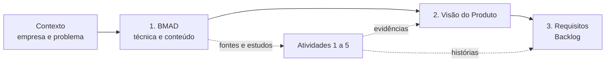

> [!abstract] O que esta seção responde
> **Como** o grupo chegou à solução e **com base em quê**. A técnica é o **BMAD**; o conteúdo é o conjunto de fontes, estudos e decisões que alimentaram cada etapa.

## Como esta seção se liga ao resto

| Quero saber... | Vá para |
| --- | --- |
| O que é o BMAD e por que serve a este projeto | [[01-bmad/o-que-e-bmad]] |
| Como cada fase do BMAD virou um documento do trabalho, e o registro de uso | [[01-bmad/aplicacao-no-projeto]] |
| De onde veio o problema | [[contexto/empresa-e-problema]] |
| O que foi decidido e delimitado | [[contexto/proposta-e-delimitacao]] |
| O produto resultante | [[02-visao-do-produto/index]] |
| O que o produto deve fazer | [[03-requisitos/index]] |

## A técnica em uma frase

O BMAD organiza o desenvolvimento assistido por IA em **papéis especializados** (analista, gerente de produto, arquiteto, desenvolvedor, testes) e em **fases** que produzem documentos encadeados, da análise do problema até a implementação. Cada documento alimenta o seguinte, o que dá **rastreabilidade** do problema à solução. Detalhes em [[01-bmad/o-que-e-bmad]].

## O conteúdo usado para buscar a solução

Fontes e estudos que sustentam as decisões, e onde aparecem:

| Conteúdo | Para que serviu | Onde aparece |
| --- | --- | --- |
| Descrição do caso (empresa, equipes, faturamento, gasto, hardware) | Definir o problema e o cliente | [[contexto/empresa-e-problema]] |
| Delimitação do projeto ("IA própria", foco do protótipo) | Manter o escopo viável | [[contexto/proposta-e-delimitacao]] |
| Modelos locais candidatos (tamanhos no Ollama, usos) | Escolher o modelo | [[referencias/modelos-candidatos]] |
| Estudo de memória e simulador de custos (20 cenários de memória, 66 verificações de cálculo) | Provar que o modelo cabe na GPU e estimar custo | [[atividades/atividade-2-custos-e-instalacao-llm]] |
| Roteiro de preparação do servidor (9 etapas, testes de 24 h) | Garantir a plataforma | [[atividades/atividade-1-servidor-padrao]] |
| Estudo de infraestrutura, capacidade, fila e diferenciais | Dimensionar e distribuir a solução | [[atividades/atividade-3-infraestrutura-e-distribuicao]] |
| Critérios de avaliação do resultado | Definir como julgar a viabilidade | [[referencias/criterios-de-avaliacao]] |
| Licenças do Ollama (MIT) e do Qwen2.5-Coder (Apache 2.0) | Garantir uso comercial | [[atividades/atividade-3-infraestrutura-e-distribuicao]] |

## Trilha de decisões (resumo)

| # | Decisão | Alternativa descartada | Registro |
| --- | --- | --- | --- |
| D1 | "IA própria" = modelo já treinado, administrado pela empresa | Treinar uma IA do zero | [[contexto/proposta-e-delimitacao]] |
| D2 | Foco: perguntas, explicações de código e correções | Substituir todas as ferramentas atuais | [[contexto/proposta-e-delimitacao]] |
| D3 | Ollama + Qwen2.5-Coder 14B | Modelos maiores (18 a 19 GB) | [[atividades/atividade-2-custos-e-instalacao-llm]] |
| D4 | Uma geração por vez, com fila e estados visíveis | Atendimento totalmente paralelo desde o início | [[atividades/atividade-2-custos-e-instalacao-llm]] |
| D5 | Gateway autenticado; Ollama só em `127.0.0.1` | Expor a API do Ollama na rede | [[atividades/atividade-1-servidor-padrao]] |
| D6 | Implantação em fases (piloto → três equipes → IDE) | Implantação única | [[atividades/atividade-3-infraestrutura-e-distribuicao]] |
| D7 | Ferramentas externas mantidas como contingência | Desligar as ferramentas externas | [[atividades/atividade-3-infraestrutura-e-distribuicao]] |
| D8 | Requisitos em **Backlog de histórias** | Requisitos tradicionais | [[03-requisitos/index]] |

O registro completo, com o mapeamento fase a fase, está em [[01-bmad/aplicacao-no-projeto]].

> [!warning] Sobre o uso real do BMAD
> A técnica foi aplicada **principalmente com o Claude**, e **não há registro dos prompts**. Esta seção mostra **onde cada fase se reflete nos documentos** e como o resultado foi **verificado** (cálculos, fontes e revisão). Ver [[01-bmad/aplicacao-no-projeto#Como a IA foi usada|Como a IA foi usada]].
