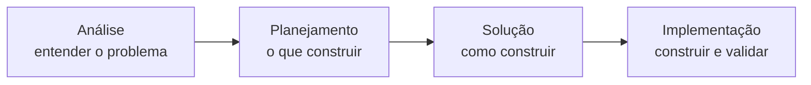

> [!info] Conexões
> Parte da seção [[01-bmad/index|Documentação da técnica e do conteúdo]]. A aplicação ao projeto está em [[01-bmad/aplicacao-no-projeto]].

> [!note] Sobre a precisão desta página
> Descrição **geral** do método. Nomes de comandos e de agentes variam entre versões; confira o repositório oficial do BMAD-METHOD na versão que o grupo usou antes de citar detalhes específicos.

## Definição

**BMAD** (*Breakthrough Method for Agile AI-Driven Development*) é um método de código aberto para conduzir um projeto de software com agentes de IA, seguindo práticas ágeis. A ideia central é simular uma equipe: cada **agente** assume um **papel** com responsabilidades e artefatos próprios.

## Os papéis

| Papel | O que faz | Artefato típico |
| --- | --- | --- |
| **Analista** | Explora o problema, pesquisa o mercado e as alternativas | Brief do projeto / pesquisa |
| **Gerente de produto (PM)** | Transforma o problema em requisitos e prioridades | Documento de requisitos do produto (PRD) |
| **Arquiteto** | Define a solução técnica e suas restrições | Documento de arquitetura |
| **Product Owner / Scrum Master** | Quebra o trabalho em épicos e histórias | Backlog, histórias detalhadas |
| **Desenvolvedor** | Implementa as histórias | Código e testes |
| **QA (testes)** | Valida o que foi entregue | Evidências de teste |

## As fases

1. **Análise:** esclarecer o problema, levantar alternativas, produzir um brief.
2. **Planejamento:** definir requisitos, escopo e prioridades.
3. **Solução:** decidir arquitetura e dividir em épicos e histórias.
4. **Implementação:** desenvolver história por história, com revisão e testes.

## Por que o BMAD serve a este projeto

- O projeto é **de viabilidade**: precisa registrar o raciocínio, e o BMAD é guiado por documentos encadeados.
- O grupo tem **seis pessoas com papéis** definidos ([[equipe/papeis-e-atividades]]), que se mapeiam bem aos papéis do método.
- A saída pedida inclui **Visão do Produto** e **Backlog**, que são exatamente artefatos de brief e de histórias.
- Como o projeto usa IA para pesquisar e redigir, o método dá **estrutura** e **rastreabilidade** ao uso dela.

## Limites do método a declarar

- A IA **apoia**; as decisões (modelo, custo, escopo) são do grupo e foram **verificadas** com cálculos e fontes, não aceitas sem conferência.
- Os números de desempenho só valem depois de medidos no servidor ([[referencias/criterios-de-avaliacao]]).

Próximo: [[01-bmad/aplicacao-no-projeto]].
