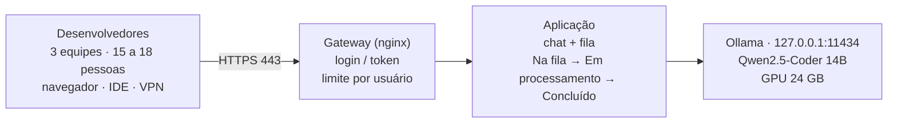
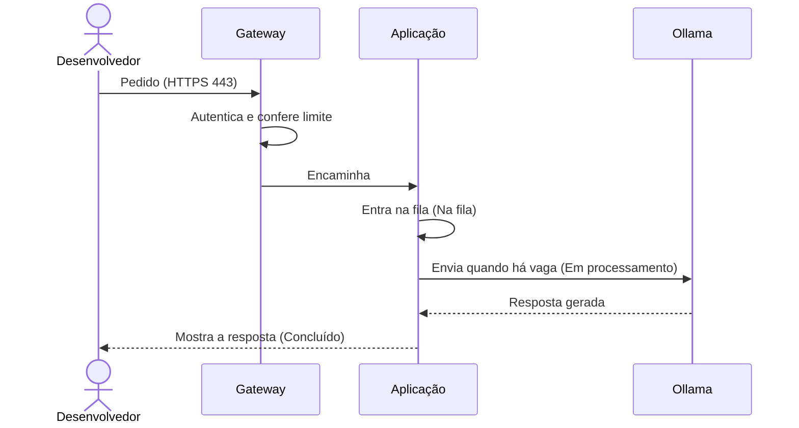

> [!info] Conexões
> Detalha [[02-visao-do-produto/index]]. Origem: [[atividades/atividade-3-infraestrutura-e-distribuicao]] (arquitetura) e [[atividades/atividade-1-servidor-padrao]] (plataforma). Requisitos de acesso: [[03-requisitos/backlog-do-produto#Épico E1: Acesso e autenticação|E1]].

## Visão geral

O desenvolvedor **nunca fala direto com o modelo**.

## Componentes

| Componente | Função | Responsável |
| --- | --- | --- |
| **Gateway (nginx, HTTPS)** | Login ou token, limite por usuário, registro de metadados | Equipe de LLM / segurança |
| **Aplicação (chat + fila)** | Interface de conversa, fila, estados do pedido | Backend e frontend |
| **Ollama** | Carrega e serve o modelo; só aceita conexões locais | Equipe de LLM |
| **Qwen2.5-Coder 14B** | Modelo de linguagem para código | Equipe de LLM |
| **Servidor Ubuntu + Docker + NVIDIA Toolkit** | Plataforma, GPU em container | Infraestrutura |
| **Prometheus, restic, NUT** | Monitoramento, backup, nobreak | Infraestrutura |

## Caminho de um pedido

Regras: **um pedido aberto por usuário**; o gateway e a aplicação **não gravam o conteúdo** do pedido nos logs.

## Decisões de arquitetura

| Decisão | Motivo |
| --- | --- |
| Ollama restrito a `127.0.0.1` | A API não exige senha; acesso só pelo gateway |
| Ollama em container, modelos em `/srv/ia` | Nada no host; reprodutível e fácil de recuperar |
| Uma geração por vez no início | Ponto de partida seguro (12,9 GiB); ampliar com medição |
| IDE só com chat | Autocompletar geraria muitos pedidos por minuto |

Mais em [[01-bmad/aplicacao-no-projeto#Registro de decisões|registro de decisões]].

## Capacidade resumida

| Gerações simultâneas | VRAM estimada | Situação |
| --- | --- | --- |
| 1 | 12,9 GiB | Ponto de partida |
| 2 | 14,4 GiB | Testar no piloto |
| 4 | 17,4 GiB | Alvo para as três equipes |
| 6 | 20,4 GiB | Limite teórico |

Valores para contexto de 8.192 tokens; ver o alerta sobre 16.384 tokens em [[atividades/atividade-3-infraestrutura-e-distribuicao#Capacidade|Capacidade]].
