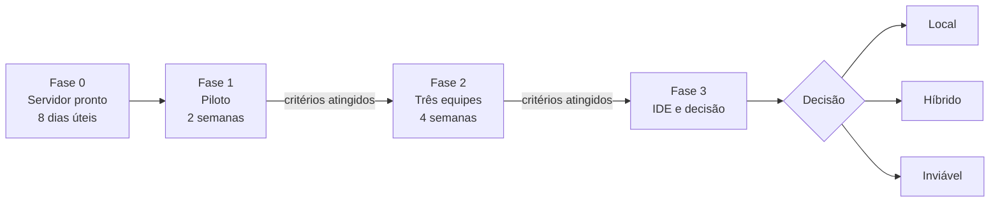

> [!info] Conexões
> Detalha [[02-visao-do-produto/index]]. As histórias de cada fase estão em [[03-requisitos/backlog-do-produto]]. O plano de implantação vem da [[atividades/atividade-3-infraestrutura-e-distribuicao|Atividade 3]].

## Dentro e fora do escopo

| Dentro (núcleo) | Fora (nesta etapa) |
| --- | --- |
| IA local atendendo as três equipes, com fila | Treinar ou ajustar um modelo próprio |
| Processamento dentro da rede interna | Substituir todas as ferramentas externas |
| Acesso por conta e rede controladas | Autocompletar na IDE (geraria muitos pedidos) |
| Chat para perguntas, explicação, correção e testes | Compra de hardware (orçamento separado) |
| Medição de qualidade, desempenho e custo | Indexação do acervo de 20 anos (Fase 2) |

## Duas camadas de fases (a unificar)

A visão comercial e o plano de implantação usam numerações diferentes. Equivalência proposta:

| Visão comercial | Plano de implantação | Conteúdo |
| --- | --- | --- |
| **Fase 1: Núcleo do Hub** (agora) | Fases 0, 1 e 2 | Servidor pronto, piloto com uma equipe, três equipes |
| **Fase 2: Governança e reuso** (a avaliar) | Fase 3 e além | IDE, roteamento híbrido, cotas e métricas, indexação do acervo |

> [!note]
> A Fase 2 comercial é desenhada **após o piloto** e **não** faz parte do escopo nem do investimento inicial.

## Fase 1 comercial: núcleo

- IA local (Qwen 14B) atendendo as três equipes, com fila.
- Todo o processamento na rede interna.
- Acesso por conta e rede, sem fornecedor externo.

## Fase 2 comercial: evolução a avaliar

- **Roteamento híbrido:** demandas complexas e **sem sigilo** podem usar APIs externas de ponta; tudo que envolve dado sensível continua local.
- **Cotas e métricas** por equipe e por projeto, visíveis à diretoria.
- **Indexação do acervo técnico** de 20 anos, para a IA sugerir código no padrão da casa.

## Plano de implantação

| Fase | Duração | O que acontece | Critério para avançar |
| --- | --- | --- | --- |
| **0. Servidor pronto** | 8 dias úteis | [[atividades/atividade-1-servidor-padrao\|Atividade 1]] + instalação do Ollama | Checklist de entrega assinado |
| **1. Piloto** | 2 semanas | Uma equipe (5–6 pessoas) pelo navegador | Espera ≤ 30 s em 95% dos pedidos; ≥ 70% de respostas úteis; sem incidente de segurança |
| **2. Três equipes** | 4 semanas | Todas as equipes, navegador e VPN; ajuste das gerações | Mesmos critérios com 15–18 pessoas; disponibilidade ≥ 98% |
| **3. IDE e decisão** | contínua | Integração com a IDE; decisão local ou híbrido | Relatório de uso e custo |

