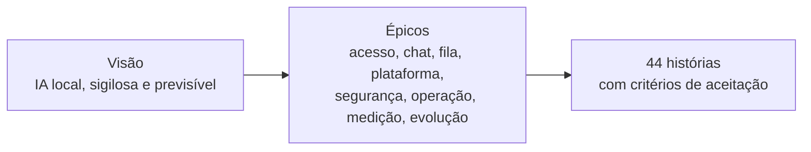

> [!abstract] O que esta seção responde
> **Qual é a solução inicial proposta.** Aqui está a visão geral; os detalhes estão nas páginas ligadas abaixo.

> [!info] Conexões
> Parte da [[01-bmad/index|análise do BMAD]] (brief do produto). Dá origem ao [[03-requisitos/index|Backlog]]. Usa os resultados das [[equipe/papeis-e-atividades|atividades 1 a 3]]. É a base da [[atividades/atividade-4-apresentacao-do-produto|apresentação]].

*Documento de pré-pitch · 05/10/2026*

## Declaração de visão

> **Para** fábricas de software que entregam sistemas a bancos, universidades e outras instituições que exigem confidencialidade, **cujo** problema é o custo crescente e o sigilo de código ao usar ferramentas de IA externas, **o Hub de IA Local é** uma instância de IA rodando na infraestrutura da própria empresa, **que** atende as três equipes por uma interface única com fila de acesso. **Diferentemente** das ferramentas por assinatura, o código **permanece dentro da empresa**, o custo é **fixo e previsível** e a empresa **controla** modelo, versão e configuração.

## O problema, em quatro pontos

| Ponto | O que acontece |
| --- | --- |
| **Custo sem teto** | O gasto atual (≈ R$ 10 mil/mês) pode crescer com o uso das equipes, sem aviso |
| **Código em trânsito** | Prompts e trechos de sistemas de clientes saem da rede a cada consulta externa |
| **Acervo técnico esquecido** | Padrões construídos em 20 anos não alimentam a IA usada hoje |
| **Nenhuma visibilidade** | Não há painel de quanto cada equipe ou projeto consome |

Origem: [[contexto/empresa-e-problema]]. Os dois últimos pontos são tratados na evolução (Fase 2), não no núcleo inicial.

## A solução proposta

- **Modelo:** Qwen2.5-Coder 14B, executado via Ollama.
- **Infraestrutura:** GPU de 24 GB de VRAM e **128 GB de RAM** já existentes (sem compra de GPU). **Nobreak e disco de dados**: compra a definir com o cliente.
- **Atendimento:** as três equipes (até 18 desenvolvedores), com **fila** organizando o acesso simultâneo.
- **Uso:** perguntas de programação, explicação de código, correção de erros e criação de testes.

> "O mesmo investimento que hoje paga uma licença por pessoa passa a sustentar as três equipes ao mesmo tempo, e o código continua dentro de casa."

## Páginas desta seção

| Página | Conteúdo |
| --- | --- |
| [[02-visao-do-produto/proposta-de-valor]] | Para quem é, benefícios, diferenciais e segurança |
| [[02-visao-do-produto/escopo-e-fases]] | O que entra e não entra; Fase 1 e Fase 2; implantação |
| [[02-visao-do-produto/arquitetura-da-solucao]] | Como o pedido percorre o sistema; componentes |
| [[02-visao-do-produto/analise-economica]] | Custos, economia, retorno e premissas |

## Documentos desta parte (anexos)

O texto acima é a versão navegável. Os documentos originais estão em [[Anexos/index|Anexos]]:

- **Pré-pitch comercial: Hub de IA Local** (parte pronta da apresentação, [[atividades/atividade-4-apresentacao-do-produto|Atividade 4]]);
- **Visão do Produto: Hub de IA Local** (3 páginas);
- **IA Local para Desenvolvimento: Proposta de Implantação** (11 páginas, em formato de slides).

## Como esta visão vira requisitos

Detalhe em [[03-requisitos/index]] e [[03-requisitos/backlog-do-produto]].

## Resultados esperados e honestidade do argumento

A visão **não promete** substituir todas as ferramentas externas. Promete uma **avaliação com critérios claros** ([[referencias/criterios-de-avaliacao]]) e uma decisão baseada em dados do piloto entre **local**, **híbrido** ou **inviável**.

## Próximo passo comercial

Conversa técnica de 40 minutos, para:

- confirmar o hardware disponível (GPU exata e RAM real) e o volume de uso de IA hoje;
- alinhar expectativas de segurança, LGPD e confidencialidade com clientes bancários;
- desenhar o piloto com **uma** das três equipes antes de qualquer decisão maior.

*Equipe de Implantação de IA Local · Projeto Integrador*
