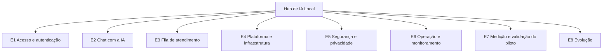

> [!abstract] O que esta seção responde
> **O que o sistema deve fazer** e **com que qualidade**, em forma de requisitos iniciais verificáveis.

> [!info] Conexões
> Nasce da [[02-visao-do-produto/index|Visão do Produto]], com apoio da [[01-bmad/index|análise do BMAD]] e dos estudos das [[equipe/papeis-e-atividades|atividades 1 a 5]].

## Formato escolhido: Backlog do Produto (histórias)

O enunciado permite **Backlog do Produto (histórias)** ou **Requisitos Tradicionais**. A escolha foi o **Backlog**, pelos motivos:

1. O **BMAD** é um método ágil que produz épicos e histórias, e o backlog se encaixa direto no fluxo ([[01-bmad/aplicacao-no-projeto]]).
2. O produto será entregue **em fases** (piloto, três equipes, IDE). O backlog permite priorizar e cortar por fase, o que requisitos tradicionais fazem com menos clareza.
3. As histórias carregam **critérios de aceitação**, que viram os testes do piloto.
4. Para não perder o que o backlog costuma deixar de lado, as qualidades do sistema (desempenho, segurança, disponibilidade, custo) foram registradas à parte, como **requisitos não funcionais**.

## Conteúdo da seção

| Página | O que traz |
| --- | --- |
| [[03-requisitos/backlog-do-produto]] | 44 histórias em 8 épicos, com prioridade, fase, origem e critérios de aceitação |
| [[03-requisitos/requisitos-nao-funcionais]] | 21 requisitos de qualidade com meta e verificação |
| [[03-requisitos/rastreabilidade]] | Matrizes: épico → origem → critério; histórias por fase |

## Visão rápida dos épicos

| Épico | Link direto |
| --- | --- |
| E1 Acesso e autenticação | [[03-requisitos/backlog-do-produto#Épico E1: Acesso e autenticação\|ver histórias]] |
| E2 Chat com a IA | [[03-requisitos/backlog-do-produto#Épico E2: Chat com a IA\|ver histórias]] |
| E3 Fila de atendimento | [[03-requisitos/backlog-do-produto#Épico E3: Fila de atendimento\|ver histórias]] |
| E4 Plataforma e infraestrutura | [[03-requisitos/backlog-do-produto#Épico E4: Plataforma e infraestrutura\|ver histórias]] |
| E5 Segurança e privacidade | [[03-requisitos/backlog-do-produto#Épico E5: Segurança e privacidade\|ver histórias]] |
| E6 Operação e monitoramento | [[03-requisitos/backlog-do-produto#Épico E6: Operação e monitoramento\|ver histórias]] |
| E7 Medição e validação do piloto | [[03-requisitos/backlog-do-produto#Épico E7: Medição e validação do piloto\|ver histórias]] |
| E8 Evolução | [[03-requisitos/backlog-do-produto#Épico E8: Evolução\|ver histórias]] |

## Como o backlog foi construído

1. Partiu-se da **questão central** e do **foco do protótipo** ([[contexto/proposta-e-delimitacao]]).
2. Cada **atividade entregue** foi lida em busca de comportamentos, regras e metas, que viraram histórias e requisitos.
3. As metas numéricas do piloto (30 s, 70%, 98%) viraram **critérios de aceitação**.
4. O que só aparece como ideia de evolução ficou como **Could**, em fases posteriores.

> [!warning] Rascunho a validar
> O backlog é uma **primeira versão**. Histórias com a marca *(proposta do grupo)* e as prioridades devem ser confirmadas por todos antes da entrega.
