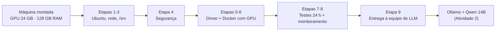

**Responsável:** Félix · **Atualizado em:** 05/10/2026 · **Documento:** v1.1 (17 páginas)

> [!success] Entrega concluída
> Roteiro completo para transformar a máquina (GPU de 24 GB + 128 GB de RAM) em um servidor **Ubuntu seguro**, com GPU utilizável em containers, pronto para a equipe de LLM instalar a IA.

> [!info] Conexões
> Fornece a plataforma para a [[atividades/atividade-2-custos-e-instalacao-llm|Atividade 2]] e é a base da [[atividades/atividade-3-infraestrutura-e-distribuicao|Atividade 3]]. Seus controles de segurança alimentam a [[atividades/atividade-5-seguranca|Atividade 5]]. Histórias relacionadas: [[03-requisitos/backlog-do-produto#Épico E4: Plataforma e infraestrutura|Épico E4]].

## O que a entrega contém

- **Roteiro em 9 etapas**, do pendrive de instalação à entrega formal à equipe de LLM, com comandos prontos.
- **Critérios objetivos de aprovação:** 24 horas de estresse com CPU, memória e GPU em carga máxima antes de liberar o servidor.
- **Segurança desde a instalação:** login só por chave SSH, firewall, proteção contra força bruta e atualizações automáticas que nunca quebram o driver da GPU.
- **Integração com a Atividade 2:** o Ollama roda em container, com a API protegida.
- **Cronograma de 8 dias úteis** + 2 semanas de suporte, e tabela de riscos com mitigação.

## Divisão de responsabilidades

A infraestrutura cuida da **plataforma**; a equipe de LLM cuida do **serviço de IA**. A fronteira é verificável: o checklist final só é assinado quando a equipe de LLM roda um container com GPU por conta própria.

| Camada (de cima para baixo) | Responsável | Etapa |
| --- | --- | --- |
| Servidor de inferência (Ollama), modelos, gateway e interface | Equipe de LLM | — |
| **Entrega:** GPU em container, contas SSH, `/srv/ia`, portas liberadas | Ambas | 9 |
| Monitoramento, contas e backup | Infraestrutura | 8 |
| Docker + NVIDIA Container Toolkit | Infraestrutura | 6 |
| Driver NVIDIA (versão fixada) | Infraestrutura | 5 |
| SSH por chave, firewall, atualizações automáticas | Infraestrutura | 4 |
| Ubuntu Server 24.04 LTS, rede, disco de dados em `/srv` | Infraestrutura | 1 a 3 |



## As 9 etapas

| Etapa | O que é feito | Duração | Entregável |
| --- | --- | --- | --- |
| **1. Preparação** | Reunir IP, DNS, versões, portas e discos; pendrive conferido por SHA256; checagem da BIOS (UEFI, Secure Boot, religar após queda de energia) | dia 1 | Formulário preenchido |
| **2. Instalação do Ubuntu** | Ubuntu Server 24.04 LTS com IP fixo, LVM e OpenSSH; **sem** Docker via snap e **sem** driver automático | dia 2 | Sistema acessível no IP fixo |
| **3. Configuração inicial** | Rede definitiva, NTP, pacotes base, swap de 16 GB, disco de dados em `/srv` | dia 3 | Reinício sem erros |
| **4. Segurança** | SSH só por chave, firewall (ufw) só para a rede interna, fail2ban, atualizações automáticas que excluem driver e Docker | dia 4 | Conferido pelo revisor |
| **5. Driver NVIDIA** | Driver da linha `-server`, modo de persistência, versão fixada (`apt-mark hold`) | dia 5 | `nvidia-smi` sem erros |
| **6. Docker + toolkit** | Docker oficial com dados em `/srv/docker`, portas só em `127.0.0.1`, NVIDIA Container Toolkit | dia 6 | GPU visível dentro de container |
| **7. Testes de carga** | gpu-burn, stress-ng, disco, 24 h combinadas, reinício e queda de energia simulada | dias 7–8 | Relatório de testes |
| **8. Monitoramento e contas** | Métricas de host e GPU, alertas, nobreak (NUT), contas da equipe de LLM, backup com restic | dias 7–8 | Alertas e restauração testados |
| **9. Entrega** | Reunião de 1 h conferindo o checklist na máquina, com as duas equipes | fim do dia 8 | Checklist assinado |

## Integração com a Atividade 2

A [[atividades/atividade-2-custos-e-instalacao-llm|Atividade 2]] adota **Ollama + Qwen2.5-Coder 14B**, uma geração por vez, cerca de 12,9 GiB de VRAM. No servidor, roda **em container**, seguindo as regras da infraestrutura: nada instalado direto no host, modelos em `/srv/ia`, portas só em `127.0.0.1`.

> [!tip] Ponto de segurança resolvido
> A API do Ollama não exige senha. Com a porta 11434 publicada só em `127.0.0.1`, ela **não fica acessível pela rede**. Os usuários chegam ao modelo apenas por um **gateway com autenticação**.

Exemplo de referência (a configuração final é da equipe de LLM):

```yaml
services:
  ollama:
    image: ollama/ollama:<versão>
    ports:
      - "127.0.0.1:11434:11434"     # só na máquina; acesso externo via gateway autenticado
    volumes:
      - /srv/ia/ollama:/root/.ollama  # modelos no disco de dados
    environment:
      - OLLAMA_NUM_PARALLEL=1         # uma geração por vez, como no estudo de custos
      - OLLAMA_MAX_LOADED_MODELS=1
    deploy:
      resources:
        reservations:
          devices:
            - driver: nvidia
              count: all
              capabilities: [gpu]
    restart: unless-stopped
```

## Segurança aplicada no servidor

| Ameaça | Controle |
| --- | --- |
| Senha fraca ou vazada | Login só por chave SSH; root bloqueado; apenas o grupo `ssh-users` entra |
| Acesso de fora da empresa | Firewall nega tudo por padrão; SSH só para a rede interna |
| Tentativas repetidas de login | fail2ban bloqueia o IP por 1 h após 5 erros |
| Docker expondo portas por cima do firewall | `"ip": "127.0.0.1"` no Docker: serviços ficam só na máquina |
| API do Ollama sem senha | Porta restrita a `127.0.0.1`; acesso apenas pelo gateway autenticado |
| Falhas de segurança no sistema | Atualizações automáticas diárias, sem mexer em driver e Docker |
| Grupo `docker` = acesso de administrador | Concedido só a quem opera containers, com registro por escrito |

## Testes e critérios de aprovação

O servidor **só é entregue** depois de 24 horas com CPU, memória e GPU em carga máxima, sem erro, travamento ou superaquecimento.

| Teste | Critério para aprovar |
| --- | --- |
| gpu-burn (2 h) | Resultado OK, sem erros Xid |
| Temperatura da GPU | Estável, sem redução de clock por temperatura sustentada |
| CPU e memória (2 h) | Sem travamento e sem erros de hardware (MCE) |
| Disco | SMART sem alertas; leitura compatível com o NVMe |
| 24 h combinadas | Nenhum reinício, travamento ou erro no log |
| Reinício e queda de energia | Volta sozinho, com GPU, `/srv` e Docker funcionando |

## Riscos principais

| Risco | Impacto | Mitigação |
| --- | --- | --- |
| Atualização automática troca driver ou Docker | Serviços de IA param | Versões fixadas e excluídas das atualizações automáticas |
| Kernel novo sem módulo NVIDIA | GPU some após reinício | `linux-headers-generic` e conferência com `dkms status` |
| Secure Boot bloqueia o driver | GPU invisível | Checagem na BIOS (Etapa 1) e registro da chave MOK (Etapa 5) |
| GPU superaquece em uso contínuo | Perda de desempenho ou desligamento | Teste de 24 h, limite de potência opcional, alerta acima de 85 °C |
| Queda de energia | Parada e risco de corromper dados | Nobreak com desligamento seguro; religamento testado |
| Discos diferentes do previsto | Retrabalho na Etapa 3 | Discos levantados na Etapa 1; alternativa para disco único |

A tabela completa (11 riscos) e o gráfico do cronograma estão nas pp. 16–17 do documento anexo.

## Checklist de entrega à equipe de LLM

- [ ] Integrante da equipe de LLM entra por SSH com a própria chave
- [ ] O mesmo integrante roda um container com GPU (`docker run --gpus all ... nvidia-smi`) sem sudo
- [ ] `/srv/ia` gravável pelo grupo `equipe-llm`, com espaço livre informado
- [ ] Versões de Ubuntu, kernel, driver, CUDA, Docker e toolkit conferidas
- [ ] Portas liberadas só para a rede interna; porta do Ollama restrita a `127.0.0.1`
- [ ] Relatório de testes de 24 h aprovado
- [ ] Alertas de hardware chegando à infraestrutura
- [ ] Backup executado e restauração testada
- [ ] Reinício e queda de energia testados

## Suposições a confirmar

- **Discos:** um para o sistema e um NVMe de dados (mín. 500 GB para `/srv`). Com disco único, a Etapa 3 traz alternativa com LVM. A compra do disco de dados e do nobreak será **definida com o cliente**.
- **Rede:** IPs, DNS e nomes (`ia-srv01`, `10.0.10.0/24`) são exemplos.
- **Hardware:** GPU de 24 GB (RTX 4090 no estudo da Atividade 2) e **128 GB de RAM (confirmado)**.

## Mudanças da v1.1

- vLLM → servidor de inferência (Ollama ou vLLM), alinhado à Atividade 2.
- Nova seção de integração com a Atividade 2 (Ollama em container, porta em `127.0.0.1`), novo risco e novo item de checklist.
- Nota de escopo: o serviço do modelo fica com a equipe de LLM.
- `linux-headers-generic` no lugar de `linux-headers-$(uname -r)`, com `dkms status` na verificação.
- Discos incluídos no levantamento da Etapa 1, com alternativa para disco único.
- Revisão de texto.

## Anexo

*Preparação do Servidor de IA – v1.1 (17 páginas).* Arquivo em [[Anexos/index|Anexos]] (`Preparacao_Servidor_IA.pdf`).
