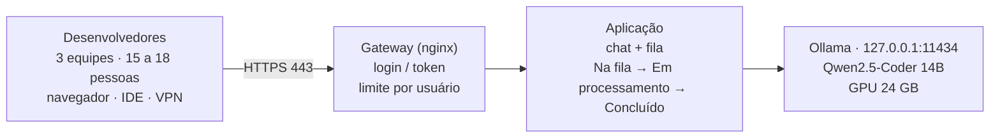

**Responsáveis:** Vitória e Félix · **Atualizado em:** 05/10/2026 · **Documento:** v1.0 (6 páginas), revisado pela Vitória

> [!success] Entrega concluída
> Define a infraestrutura para a IA local atender as três equipes, como a solução chega aos desenvolvedores e o que ela tem de diferente das ferramentas externas pagas hoje.

> [!info] Conexões
> Usa a plataforma da [[atividades/atividade-1-servidor-padrao|Atividade 1]] e os números da [[atividades/atividade-2-custos-e-instalacao-llm|Atividade 2]]. Deixa a política de registros para a [[atividades/atividade-5-seguranca|Atividade 5]]. Origem das histórias dos épicos [[03-requisitos/backlog-do-produto#Épico E1: Acesso e autenticação|E1]], [[03-requisitos/backlog-do-produto#Épico E6: Operação e monitoramento|E6]] e [[03-requisitos/backlog-do-produto#Épico E8: Evolução|E8]].

## Resumo

| Pergunta | Resposta curta |
| --- | --- |
| **Infraestrutura** | A máquina existente (24 GB de VRAM, 128 GB de RAM) é suficiente para o Qwen2.5-Coder 14B. **Compra a definir com o cliente:** nobreak e disco de dados. Acesso pela rede/VPN a configurar. Todo o software é gratuito e de código aberto. |
| **Distribuição** | Em fases: piloto com uma equipe, depois as três pelo navegador, depois a IDE. Todo acesso passa por um gateway com login, nunca direto no modelo. |
| **Diferencial** | O código dos clientes (incluindo bancos) não sai da empresa; custo fixo e previsível; sem limite por usuário nem cobrança por uso. |
| **Principal risco** | Fila nos horários de pico e servidor único. Mitigação: ajustar as gerações simultâneas com base em medições e manter ferramentas externas como contingência. |

## Arquitetura

O desenvolvedor **nunca fala direto com o modelo**. Todo pedido passa pelo gateway (login, limites, registro) e pela aplicação (chat e fila). O Ollama só aceita conexões da própria máquina.

## Infraestrutura necessária

### Hardware

| Item | Situação | Por que é necessário |
| --- | --- | --- |
| GPU com 24 GB de VRAM | Já existe | Executa o modelo (≈ 12,9 GiB com uma geração por vez), com folga para mais pessoas |
| 128 GB de RAM | Já existe | Sistema, containers e cache do modelo; sobra para testar modelos maiores |
| Disco NVMe (≥ 500 GB; 1 TB recomendado) | **Compra a definir com o cliente** | Modelos (7 a 19 GB cada), imagens Docker e backups |
| Nobreak senoidal (1.200 W reais) | **Compra a definir com o cliente** | O sistema passa de 800 W sob carga; dimensionado em watts, não só em VA |
| Rede cabeada gigabit e refrigeração | Confirmar | IP fixo e temperatura estável em uso contínuo |

Nobreak e disco entram como **orçamento separado, a definir com o cliente**, assim como qualquer expansão futura.

### Software (sem custo de licença)

Ubuntu Server 24.04 LTS · Docker + NVIDIA Container Toolkit · **Ollama (MIT)** + **Qwen2.5-Coder 14B (Apache 2.0)**, licenças conferidas e compatíveis com uso comercial · nginx com HTTPS · aplicação do grupo (chat + fila) · Prometheus, restic e NUT.

### Capacidade

Cada geração simultânea extra, com contexto de 8.192 tokens, reserva ≈ 1,5 GiB de VRAM.

| Gerações simultâneas | VRAM estimada | Situação |
| --- | --- | --- |
| 1 (Atividade 2) | 12,9 GiB | Seguro; ponto de partida |
| 2 | 14,4 GiB | Testar no piloto |
| 4 | 17,4 GiB | Alvo para as 3 equipes, se os testes aprovarem |
| 6 | 20,4 GiB | Limite teórico; folga pequena |

> [!warning] Contexto maior reduz a capacidade
> O alvo de 4 gerações vale para contexto de 8.192 tokens. Com 16.384 tokens, cada geração reserva ≈ 3 GiB e 4 simultâneas já não cabem nos 24 GB.

### Tempo de espera (estimativa; medir no piloto)

Premissa: resposta típica de ≈ 10 s.

| Situação | Ocupação da GPU | Espera média |
| --- | --- | --- |
| Uso normal (15 pessoas, 6 pedidos/h) | 25% | ≈ 2 s |
| Pico (15 pessoas, 20 pedidos/h) | 83% | ≈ 25 s |
| 15 pedidos no mesmo instante, 1 geração | 100% | último ≈ 2 min 20 s |
| 15 pedidos no mesmo instante, 4 gerações | 100% | último ≈ 45 s |

**Sensibilidade:** se a resposta média passar de ≈ 12 s, o pico leva uma geração por vez a 100% de ocupação e a fila acumula. Nesse caso usam-se mais gerações simultâneas, sem comprar hardware.

## Distribuição

### Canais

| Canal | Como funciona | Fase |
| --- | --- | --- |
| **Navegador** | Endereço interno (ex.: `https://ia.empresa.local`) com login, chat e fila. Nenhuma instalação. | 1 e 2 |
| **VPN** | Mesmo endereço, acessado de fora pela VPN. O servidor nunca fica exposto na internet. | 2 |
| **IDE** | Extensão do VS Code ou JetBrains (ex.: Continue) usando a API compatível com OpenAI do Ollama, pelo gateway e com token individual. **Só chat**: o autocompletar geraria muitos pedidos por minuto. | 3 |

### Regras de acesso

- **Quem:** só integrantes das três equipes, com conta individual.
- **Por onde:** só rede interna ou VPN, só pela porta 443 do gateway. A porta 11434 não é acessível pela rede.
- **Quanto:** um pedido aberto por usuário.
- **O que fica registrado:** quem pediu, quando e quanto tempo levou. **O conteúdo do código não é guardado**; gateway e aplicação não gravam o corpo das requisições nos logs. A política final fica com a [[atividades/atividade-5-seguranca|frente de segurança]].
- **Desligamento de funcionário:** conta revogada (Atividade 1, Etapa 8).

### Implantação em fases

| Fase | Duração | O que acontece | Critério para avançar |
| --- | --- | --- | --- |
| **0. Servidor pronto** | 8 dias úteis | Atividade 1 + instalação do Ollama | Checklist de entrega assinado |
| **1. Piloto** | 2 semanas | Uma equipe (5–6 pessoas) pelo navegador; ferramentas externas continuam; testes com 1 e 2 gerações | Espera ≤ 30 s em 95% dos pedidos; ≥ 70% das respostas úteis; nenhum incidente de segurança |
| **2. Três equipes** | 4 semanas | Todas as equipes, navegador e VPN; ajuste das gerações (alvo: 4) | Mesmos critérios com 15–18 pessoas; disponibilidade ≥ 98% no horário comercial |
| **3. IDE e decisão** | contínua | Integração com a IDE; decisão entre cenário local ou híbrido | Relatório de uso e custo |

### Continuidade

Se o servidor parar, um alerta automático avisa a infraestrutura e os desenvolvedores usam as ferramentas externas mantidas no cenário híbrido. O nobreak cuida das quedas de energia; a reinstalação segue o roteiro e o backup da Atividade 1. Servidor único é aceitável **enquanto houver essa contingência**.

## Diferenciais

| Critério | Ferramentas externas (hoje) | IA local (proposta) |
| --- | --- | --- |
| **Sigilo do código** | Enviado a servidores de terceiros | **Não sai da empresa** (bancos, contratos de sigilo, LGPD) |
| **Custo** | ≈ R$ 10.000/mês, variável | R$ 3.858,40 (local) ou R$ 7.858,40 (híbrido), fixo. **Economia de R$ 6.141,60 ou R$ 2.141,60 por mês** |
| **Limite de uso** | Cotas e cobrança por usuário ou uso | Sem cota e sem cobrança por pedido |
| **Controle** | Fornecedor muda modelo, preço e termos | A empresa escolhe modelo, versão e configuração |
| **Internet** | Depende | Funciona na rede interna |
| **Personalização** | Limitada ao produto | Padrões da empresa; no futuro, consulta à documentação interna |
| **Hardware** | — | Aproveita equipamento existente |

### Limitações e tratamento

- **Modelo de 14B inferior aos comerciais de ponta em tarefas complexas:** foco em explicar código, corrigir erros e criar testes; híbrido para tarefas difíceis; qualidade medida no piloto.
- **Capacidade no pico:** fila com estados visíveis, um pedido por usuário, ajuste das gerações simultâneas.
- **Manutenção interna:** roteiros, monitoramento e backup da Atividade 1; suporte já orçado na Atividade 2.
- **Servidor único:** contingência com ferramentas externas.

> [!tip] Posicionamento
> A proposta **não** promete substituir todas as ferramentas externas. O diferencial é oferecer uma IA **sigilosa, de custo previsível e sob controle da empresa** para as tarefas do dia a dia, e usar os dados do piloto para decidir, com números, quanto do gasto atual pode ser reduzido.

## Premissas a validar no piloto

| Premissa | Valor usado | Como será medida |
| --- | --- | --- |
| Tempo típico de resposta | ≈ 10 s (alerta acima de 12 s) | Duração de cada pedido no gateway |
| Padrão de uso | 6 pedidos/h por pessoa (normal); 20 (pico) | Pedidos por hora no gateway |
| VRAM por geração extra | ≈ 1,5 GiB (contexto 8.192) | `nvidia-smi` com 1, 2 e 4 gerações |
| Qualidade | ≥ 70% das respostas úteis | Avaliação no chat pela equipe piloto |
| Disponibilidade | ≥ 98% no horário comercial | Monitoramento da Atividade 1 |

## Anexo

*Infraestrutura e Distribuição da Solução de IA – v1.0 (6 páginas).* Arquivo a ser adicionado ao repositório.
