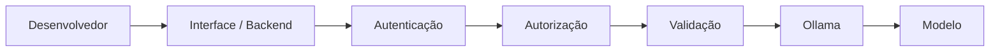

**Responsáveis:** Matheus e Thiago · **Documento-base:** *Instruções de Segurança, Hub de IA Local para Fábrica de Software* (3 páginas), em [[Anexos/index|Anexos]]

> [!info] Conexões
> Define a política que a [[atividades/atividade-3-infraestrutura-e-distribuicao|Atividade 3]] deixou em aberto (registros e conteúdo) e dá nome e prioridade aos controles técnicos da [[atividades/atividade-1-servidor-padrao|Atividade 1]]. Origem das histórias do [[03-requisitos/backlog-do-produto#Épico E5: Segurança e privacidade|Épico E5]]. Argumento de sigilo da [[02-visao-do-produto/proposta-de-valor|Proposta de valor]].

## Objetivo

Estabelecer controles de segurança para o uso de uma IA local destinada às três equipes, com foco em **proteção de código, confidencialidade, controle de acesso, auditoria e redução da exposição de dados**.

> [!important] Princípio central: Security by Design
> O fato de o processamento ser local **reduz a exposição a serviços externos, mas não torna o sistema automaticamente seguro**. A segurança depende da arquitetura, da configuração e dos controles implementados.

## 1. Controle de acesso

- Conta **individual** para cada desenvolvedor; evitar contas compartilhadas.
- **Autenticação** antes de qualquer acesso ao Hub.
- **Menor privilégio:** cada usuário só tem os acessos necessários.
- Controle por **equipe** e, quando necessário, por **projeto**.
- **Revogação imediata** em desligamento ou mudança de função.
- Sessões com **expiração** e proteção contra tentativas repetidas de autenticação.

## 2. Isolamento e segurança da rede

- Servidor de IA **fora da exposição direta à internet**.
- **Firewall** permitindo só as conexões necessárias; fechar portas e serviços sem uso.
- **Não expor a API do Ollama** diretamente aos computadores dos usuários quando houver backend intermediário.
- Acesso administrativo restrito a administradores autorizados.

## 3. Arquitetura de acesso à IA

Os controles ficam **antes do modelo**, e nenhum usuário acessa direto o serviço de inferência. É a mesma ideia do gateway com fila descrito em [[02-visao-do-produto/arquitetura-da-solucao]].

## 4. Proteção de prompts, código e histórico

- **Política clara** sobre o que pode ser enviado à IA.
- **Evitar armazenar** o conteúdo completo de prompts e respostas quando não for necessário.
- Definir **prazo de retenção** para o que precisar ser mantido.
- Restringir o acesso a históricos e logs.
- **Nunca registrar** senhas, tokens, chaves privadas ou outros segredos.
- Avaliar com cuidado qualquer funcionalidade futura de histórico ou reutilização de conhecimento (relevante para a indexação do acervo, [[03-requisitos/backlog-do-produto|US-35]]).

## 5. DLP e dados sensíveis (evolução)

O Hub pode identificar dados potencialmente sensíveis **antes** do processamento:

| Categoria | Exemplos | Ação sugerida |
| --- | --- | --- |
| Credenciais | senhas, API keys, tokens | alertar ou mascarar |
| Chaves | chaves privadas, certificados | bloquear ou mascarar |
| Dados pessoais | CPF, e-mail, identificadores | avaliar necessidade e mascarar |
| Banco / infraestrutura | connection strings, credenciais de banco | alertar ou bloquear |

## 6. Segurança específica da IA

- **Prompt injection:** tratar o conteúdo do usuário como **dado**, e não como autoridade para alterar as regras do sistema.
- **Separar** instruções do sistema, regras de segurança, solicitação do usuário e dados/código fornecidos.
- Evitar que o modelo tenha **acesso desnecessário** a sistemas, arquivos ou informações internas.
- **Monitorar** comportamentos anômalos e tentativas de abuso.
- **Revisar as respostas** antes de aplicar automaticamente alterações no código.

## 7. Logs e auditoria

O objetivo é registrar o suficiente para investigar **sem transformar os logs em cópia do código confidencial**.

| Evento | Recomendação |
| --- | --- |
| Login / logout | Registrar |
| Usuário e equipe | Registrar |
| Data e horário | Registrar |
| Quantidade de solicitações | Registrar |
| Tempo de processamento | Registrar |
| Erros e falhas | Registrar |
| Tentativas de acesso indevido | **Registrar e alertar** |
| Prompt / código completo | **Evitar** armazenamento desnecessário |

## 8. Segurança do servidor

- Sistema e componentes atualizados com patches de segurança.
- Firewall e serviços expostos mínimos; SSH protegido e acesso administrativo limitado.
- **Contas administrativas separadas** das comuns.
- Considerar **criptografia do armazenamento**, conforme a infraestrutura.
- Monitoramento e **EDR/antivírus** quando aplicável.
- Documentar mudanças de configuração relevantes.

A implementação desses itens está no roteiro da [[atividades/atividade-1-servidor-padrao|Atividade 1]] (etapas 4 e 8).

## 9. Backup e recuperação

- Definir **o que** realmente precisa de backup.
- Backups **separados do servidor principal**, com acesso restrito.
- **Testar a restauração** periodicamente.
- Procedimento de recuperação após falha, comprometimento ou indisponibilidade.

## 10. LGPD e confidencialidade

O contexto inclui clientes como bancos e universidades, em que código e prompts podem ter caráter confidencial. A arquitetura local **reduz** a necessidade de enviar esses dados a fornecedores externos, mas as **políticas internas, os contratos e os requisitos de cada cliente continuam valendo**.

## 11. Controles prioritários para o MVP

| Prioridade | Controle | História |
| --- | --- | --- |
| **Alta** | Acesso autenticado e individual | US-01 |
| **Alta** | Servidor não exposto à internet | US-02, US-22 |
| **Alta** | Firewall e portas mínimas | US-22 |
| **Alta** | Ollama protegido atrás do backend | US-21 |
| **Alta** | Revogação de usuários desligados | US-03 |
| **Alta** | Não registrar segredos em logs | US-39 |
| Média | Auditoria de acessos e uso | US-20, US-38 |
| Média | Detecção / mascaramento de dados sensíveis | US-40 |
| Média | Backups e teste de restauração | US-17 |
| Evolução | DLP mais avançado e métricas por equipe e projeto | US-34, US-40 |

As histórias completas, com critérios de aceitação, estão no [[03-requisitos/backlog-do-produto#Épico E5: Segurança e privacidade|Épico E5]].

## Coerência com as outras atividades

| Tema | Atividades 1 e 3 | Atividade 5 | Situação |
| --- | --- | --- | --- |
| Conteúdo do código nos logs | Não é guardado | Evitar armazenamento desnecessário | **Compatíveis**: manter a regra mais estrita |
| API do Ollama | Só em `127.0.0.1` | Não expor diretamente | **Compatíveis** |
| Quem acessa | Integrantes das três equipes | Por equipe e, se preciso, por projeto | A 5 **detalha** a regra |
| Retenção de registros | Não definida | Definir prazo | **Em aberto**: falta o prazo |
| Cenário híbrido | "Dado sensível fica local" | Política sobre o que pode ser enviado | **Em aberto**: falta a regra de classificação |

## Pontos em aberto

1. **Prazo de retenção** dos registros que precisarem ser mantidos.
2. **Regra de classificação** do que é dado sensível, necessária para o cenário híbrido.
3. **Política de uso**: o que pode e o que não pode ser enviado à IA.
4. **Criptografia do armazenamento**, a decidir conforme a infraestrutura.
5. **EDR/antivírus**: se haverá no servidor.
6. **Tokens da IDE** (Fase 3): emissão, validade e revogação.
7. **Contratos dos clientes**: verificar cláusulas sobre uso de IA, mesmo local.

## Critério do piloto

**Nenhum incidente de segurança** é um dos critérios para avançar de fase ([[referencias/criterios-de-avaliacao]]).
