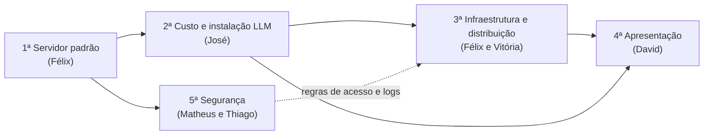

> [!info] Conexões
> Cada atividade abaixo tem uma página própria, e cada uma delas alimenta histórias do [[03-requisitos/index|Backlog]].

## Papéis de responsabilidade

Os cargos são **papéis de responsabilidade**: cada integrante responde por uma frente, mas colabora com as demais.

| Nº | Papel no projeto | Principais atividades | Entregas |
| --- | --- | --- | --- |
| 1 | **Líder do projeto e analista de requisitos** | Cronograma e distribuição de tarefas; levantamento de necessidades do cliente fictício; prioridades e limites; consolidar a análise de custos | Descrição do cliente, documento de requisitos, cronograma, acompanhamento, análise econômica |
| 2 | **Responsável por IA e arquitetura** | Comparar modelos; verificar licenças; definir critérios de escolha; desenhar a solução; avaliar qualidade das respostas com o responsável pelos testes | Quadro comparativo dos modelos, arquitetura, justificativa da escolha |
| 3 | **Infraestrutura e segurança** | Confirmar especificações da máquina; preparar o ambiente; configurar o serviço do modelo; acesso e permissões; acompanhar GPU, RAM e processamento; documentar instalação e recuperação | Ambiente configurado, registro de configurações, controles de acesso, manual de instalação |
| 4 | **Desenvolvedor de backend e integrações** | Receber solicitações e falar com o modelo; regras de acesso; erros e indisponibilidade; processamento das solicitações; registros técnicos para testes | Serviço de integração, documentação das interfaces, testes da comunicação |
| 5 | **Desenvolvedor de frontend e UX** | Telas; interface de conversa; envio e exibição de respostas; trechos de código legíveis; estados de carregamento e erro; usabilidade | Protótipo de telas, interface funcional, guia de uso |
| 6 | **Analista de testes, qualidade e validação** | Cenários de teste; avaliar respostas com exemplos de programação; medir tempo de resposta e usuários simultâneos; registrar falhas; reunir evidências | Plano de testes, registro de problemas, indicadores, relatório de validação |

**Backend** é a parte que processa as solicitações e conecta o sistema à IA. **Frontend** é a interface usada pelas pessoas.

### Como evitar uma divisão desequilibrada

- **Cada integrante documenta a própria frente**; o líder organiza a versão final.
- Todos participam dos testes de uso e conhecem o funcionamento geral para a apresentação.
- Entregas combinadas: quem pesquisa a IA trabalha com quem configura a infraestrutura; interface com integração; e o responsável pelos testes acompanha o projeto desde o início.

## As cinco atividades do grupo

| Nº | Atividade | Responsável | Página | Situação |
| --- | --- | --- | --- | --- |
| 1ª | **Servidor padrão**: configuração e preparação do servidor | Félix | [[atividades/atividade-1-servidor-padrao]] | Entregue (doc. v1.1) |
| 2ª | **Custo e instalação da LLM**: custos e procedimentos de instalação | José | [[atividades/atividade-2-custos-e-instalacao-llm]] | Entregue |
| 3ª | **Infraestrutura e diferencial (distribuição)** | Félix e Vitória | [[atividades/atividade-3-infraestrutura-e-distribuicao]] | Entregue (doc. v1.0) |
| 4ª | **Apresentação do produto** | David | [[atividades/atividade-4-apresentacao-do-produto]] | Material-base pronto (pré-pitch); apresentação a montar |
| 5ª | **Segurança**: proteção de dados, controle de acesso, boas práticas | Matheus e Thiago | [[atividades/atividade-5-seguranca]] | Documento ainda não recebido |

## Ordem lógica de dependência

A 1ª entrega a plataforma sobre a qual a 2ª instala o modelo. A 3ª usa a capacidade e o custo da 2ª para definir distribuição e diferenciais. A 5ª define a política final de acesso e registros que a 3ª deixou em aberto. A 4ª reúne tudo para apresentar.
