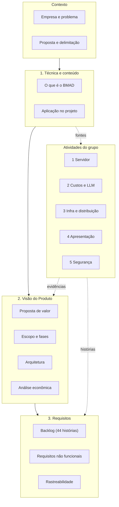

# Projeto Integrador II
### Hub de IA Local: viabilidade de uma solução interna de Inteligência Artificial para apoio ao desenvolvimento de software

**Graduação em Sistemas de Informação · Projeto Integrador II · Atualizado em 05/10/2026**

## Resumo do projeto

Uma fábrica de software com cerca de 20 anos de mercado, três equipes (15 a 18 desenvolvedores) e clientes como bancos e uma universidade gasta cerca de **R$ 10 mil por mês** com ferramentas de IA externas. A empresa já tem uma máquina com **GPU de 24 GB de VRAM e 128 GB de RAM**.

> [!question] Questão central
> A infraestrutura existente permite oferecer uma solução de IA que atenda às necessidades das equipes, com qualidade e desempenho adequados, a um custo total inferior ao das ferramentas atualmente utilizadas?

O trabalho propõe e avalia um **protótipo** baseado em um modelo já treinado (Qwen2.5-Coder 14B, via Ollama), com fila de atendimento, e **não promete** uma economia antes de demonstrá-la. O resultado pode ser substituição parcial, uso combinado ou inviabilidade ([[contexto/proposta-e-delimitacao]]).

## Mapa do projeto

---

## Os três pilares do trabalho

### 1. Documentação da técnica e do conteúdo (BMAD)

**Pergunta:** como o grupo chegou à solução e com base em quê?

Explica o método **BMAD** (papéis de IA e fases encadeadas), mostra como cada fase se reflete nos documentos do trabalho, reúne as **fontes e estudos** que sustentaram as decisões e registra a **trilha de decisões** (D1 a D8).

| Página | Conteúdo |
| --- | --- |
| [[01-bmad/index\|Visão geral da seção]] | Fontes usadas, trilha de decisões resumida |
| [[01-bmad/o-que-e-bmad]] | Conceito, papéis, fases e por que serve a este projeto |
| [[01-bmad/aplicacao-no-projeto]] | Mapa fase a fase, rastreabilidade, registro de decisões e quadro de uso |

**Liga-se a:** o problema ([[contexto/empresa-e-problema]]) entra como análise; a saída vira [[02-visao-do-produto/index|Visão do Produto]].

### 2. Solução inicial proposta (Visão do Produto)

**Pergunta:** qual é a solução e por que vale avaliá-la?

O **Hub de IA Local**: IA rodando na própria infraestrutura, com gateway autenticado e fila, atendendo as três equipes e mantendo o código dos clientes dentro da empresa.

| Página | Conteúdo |
| --- | --- |
| [[02-visao-do-produto/index\|Visão do Produto]] | Declaração de visão, problema em 4 pontos, solução |
| [[02-visao-do-produto/proposta-de-valor]] | Para quem é, benefícios, segurança e limites |
| [[02-visao-do-produto/escopo-e-fases]] | Dentro e fora do escopo, Fase 1 e 2, plano de implantação |
| [[02-visao-do-produto/arquitetura-da-solucao]] | Componentes, fluxo do pedido, decisões e capacidade |
| [[02-visao-do-produto/analise-economica]] | R$ 3.858,40 (local) e R$ 7.858,40 (híbrido) contra R$ 10.000 |

**Liga-se a:** é derivada do BMAD e se desdobra em [[03-requisitos/index|Requisitos]]. Seu conteúdo técnico vem das atividades 1 a 3.

### 3. Documento de Requisito Inicial (Backlog do Produto)

**Pergunta:** o que o sistema deve fazer e com que qualidade?

Escolhido o formato **Backlog do Produto em histórias**, por combinar com o BMAD e com a entrega em fases. As qualidades do sistema ficam em requisitos não funcionais.

| Página | Conteúdo |
| --- | --- |
| [[03-requisitos/index\|Visão geral da seção]] | Por que backlog, como foi construído |
| [[03-requisitos/backlog-do-produto]] | 44 histórias em 8 épicos, com critérios de aceitação |
| [[03-requisitos/requisitos-nao-funcionais]] | 21 requisitos com meta e verificação |
| [[03-requisitos/rastreabilidade]] | Épico → origem → critério; histórias por fase |

**Liga-se a:** cada história aponta a [[equipe/papeis-e-atividades|atividade]] de origem e os [[referencias/criterios-de-avaliacao|critérios de avaliação]] que a verificam.

---

## Atividades do grupo

| Nº  | Atividade                                                                               | Responsável      | Situação     |
| --- | --------------------------------------------------------------------------------------- | ---------------- | ------------ |
| 1   | [[atividades/atividade-1-servidor-padrao\|Servidor padrão]]                             | Félix            | Entregue     |
| 2   | [[atividades/atividade-2-custos-e-instalacao-llm\|Custo e instalação da LLM]]           | José             | Entregue     |
| 3   | [[atividades/atividade-3-infraestrutura-e-distribuicao\|Infraestrutura e distribuição]] | Félix e Vitória  | Entregue     |
| 4   | [[atividades/atividade-4-apresentacao-do-produto\|Apresentação do produto]]             | David            | Em andamento |
| 5   | [[atividades/atividade-5-seguranca\|Segurança]]                                         | Matheus e Thiago | Entregue     |

Papéis e divisão de trabalho em [[equipe/papeis-e-atividades]].

## Material de apoio

- [[contexto/empresa-e-problema]]
- [[contexto/proposta-e-delimitacao]]
- [[referencias/modelos-candidatos]]
- [[referencias/criterios-de-avaliacao]]

## Como ler o site

- **Visão rápida (5 min):** esta página, depois [[02-visao-do-produto/index]].
- **Entender o método:** [[01-bmad/index]] e [[01-bmad/aplicacao-no-projeto]].
- **Conferir requisitos:** [[03-requisitos/backlog-do-produto]].
- **Conferir números:** [[02-visao-do-produto/analise-economica]].
- **Seguir a lógica ponta a ponta:** problema → BMAD → visão → requisitos → atividades → critérios, nesta ordem.

## Números-chave

| Indicador | Valor |
| --- | --- |
| Gasto atual com IA | ≈ R$ 10.000/mês (1% do faturamento mensal) |
| Custo local estimado | R$ 3.858,40/mês |
| Custo híbrido estimado | R$ 7.858,40/mês |
| Economia potencial | R$ 6.141,60 (local) ou R$ 2.141,60 (híbrido) por mês |
| Implantação-base | R$ 6.000 |
| Modelo | Qwen2.5-Coder 14B (≈ 12,9 GiB de VRAM com 1 geração) |
| Usuários | 15 a 18 desenvolvedores, 3 equipes |

> [!warning] Estado do trabalho
> Valores são **estimativas de planejamento**, e o desempenho real será medido no piloto. Os itens em aberto são tratados pelo grupo fora do site.
